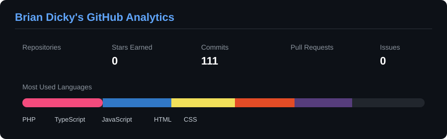

1| <h1 align="center">Hi  , I'm Brian Dicky</h1>
2| 
3| 

4|   <a href="https://readme-typing-svg.demolab.com">
6| 
7| ---
8| 
9| <table width="100%">
10|   <tr>
11|     <td width="70%" valign="top">
12|       

13|         <b>Hello there!</b> I'm <b>Brian Dicky</b>, an Informatics undergraduate at <b>UPN "Veteran" Jawa Timur</b> with a strong interest in fullstack web development and practical software engineering.
14|           
15|         My technical journey focuses on <b>Laravel, PHP, JavaScript, React, MySQL, REST APIs</b>, and modern web technologies. I enjoy building practical applications, working with backend systems, and learning through real-world product development.
16|       

17|     </td>
18|     <td width="30%" align="center" valign="middle">
19|       
20|     </td>
21|   </tr>
22| </table>
23| 
24| 
<b><i>❝ Always learning. Always building. ❞</i></b>

25| 
26| ---
27| 
28| <h3> About Me</h3>
29| 
30| - 🎓 Informatics undergraduate at <b>UPN "Veteran" Jawa Timur</b>
31| - 🚀 Building practical web apps and backend systems
32| - 🧩 Interested in fullstack web development, clean architecture, and software engineering
33| - 📚 Continuously learning modern web technologies and product-focused development
34| 
35| ---
36| 
37| 

38| 
 <b>Technology Stack</b>

39|  
40| <table width="95%" align="center" border="1" cellpadding="18" cellspacing="0">
41|   <tr>
42|     <td width="50%" align="center" valign="top"><h4>Programming Languages</h4>
    
</td>
43|     <td width="50%" align="center" valign="top"><h4>Frameworks & Libraries</h4>
   
</td>
44|   </tr>
45|   <tr>
46|     <td width="50%" align="center" valign="top"><h4>Database & Services</h4>

</td>
47|     <td width="50%" align="center" valign="top"><h4>Tools & Platforms</h4>
   
</td>
48|   </tr>
49| </table>
50| 

51| 
52| ---
53| 
54| 

55| 
 <b>GitHub Analytics</b>

56|  
57| 

58|  
59| <h3 align="center"> Additional GitHub Analytics</h3>
60| 

61| 

62| 
63| ---
64| 
65| 
<h3> Connect With Me</h3> 

66| 
